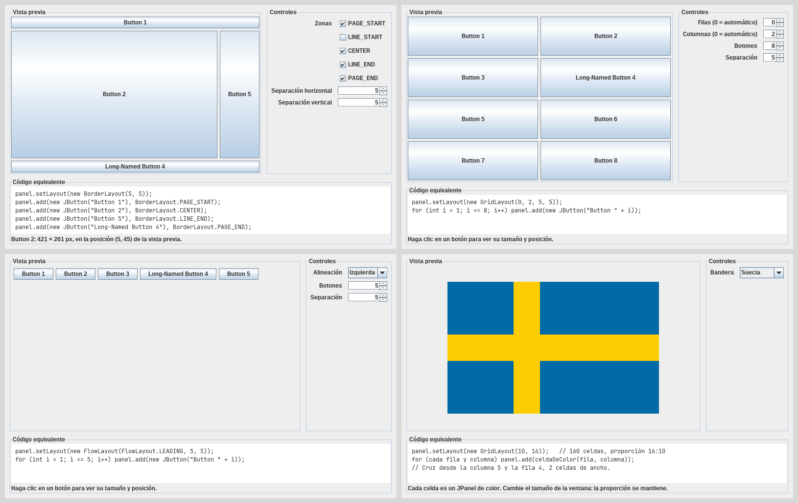

# java-swing-layouts

[](https://github.com/Whiteherobot/java-swing-layouts/actions/workflows/ci.yml)

Explorador de layouts de Swing. Ejercicio 03.01 de Programación Orientada a
Objetos (mayo de 2022), en grupo: ventanas y paneles.

En Swing, un *layout* es la regla que decide dónde va cada componente y cuánto
mide cuando cambia el tamaño de la ventana. Esta aplicación permite modificar
cada layout y ver el resultado al instante, junto con el código Java que lo
produce.



- **BorderLayout**: cinco zonas. Al desactivar zonas se ve que el centro siempre
  ocupa el espacio libre y los bordes solo su tamaño preferido. Es el layout
  típico para la estructura de una ventana.
- **GridLayout**: celdas iguales. Se pueden cambiar filas, columnas y cantidad
  de botones. Cuando se fijan filas y columnas a la vez, Java respeta las filas
  y recalcula las columnas, y el código lo indica.
- **FlowLayout**: componentes en fila con su tamaño natural. Al achicar la
  ventana pasan a la siguiente línea, y se puede cambiar la alineación.
- **Banderas**: Noruega, Suecia, Dinamarca, Finlandia e Islandia dibujadas con
  un `GridLayout` de celdas de color, cada una con sus proporciones oficiales.
  Todas comparten el mismo algoritmo de la cruz nórdica, que solo cambia de
  posición, ancho, borde y colores.

Al hacer clic en cualquier botón de la vista previa, abajo se muestran su tamaño
y su posición, es decir, el espacio que le asignó el layout.

## Cómo correrlo

Necesitas JDK 17 o superior. El proyecto trae el wrapper de Maven.

```bash
./mvnw verify                             # compila y corre las pruebas
java -jar target/swing-layouts-1.0.0.jar
```

Las pruebas verifican la ubicación de los componentes, el código generado y las
proporciones de cada bandera, y corren en GitHub Actions con Java 17 y 21.

## Qué cambió desde la entrega

En 2022 eran cuatro ventanas fijas que se cerraban todas juntas, con etiquetas
que hacían de botones. La bandera de Noruega se pintaba celda por celda en 120
líneas y salía deformada, con dos filas rojas arriba y una abajo. En 2026 se
convirtió en un explorador interactivo, con una pestaña por layout, y la bandera
pasó a ser un generador de banderas nórdicas con proporciones correctas.

## Autores

- Michael Lata ([@Whiteherobot](https://github.com/Whiteherobot)): layouts
- Gabriela Rocano: bandera

Licencia MIT.
